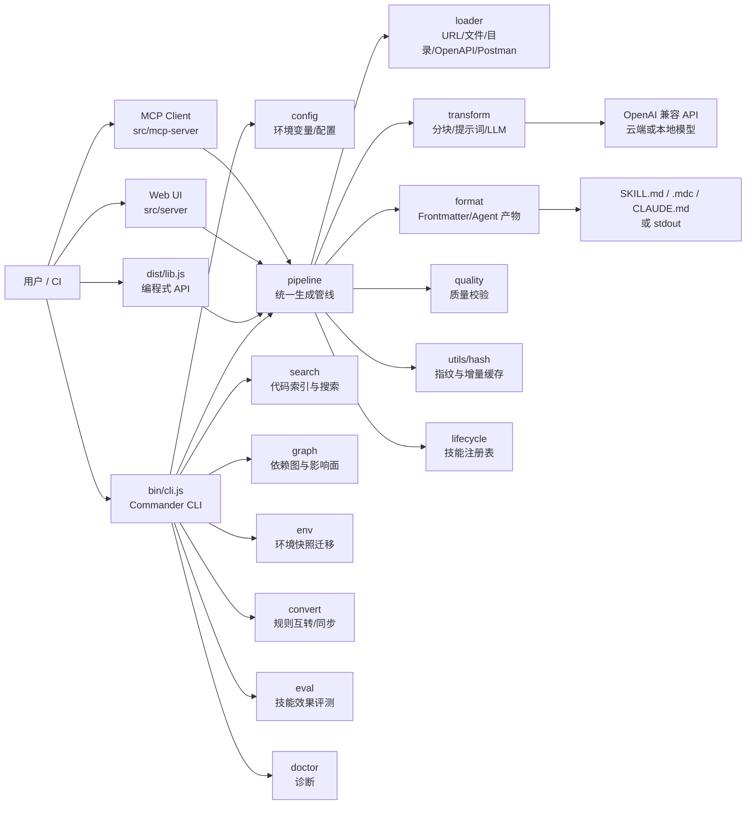
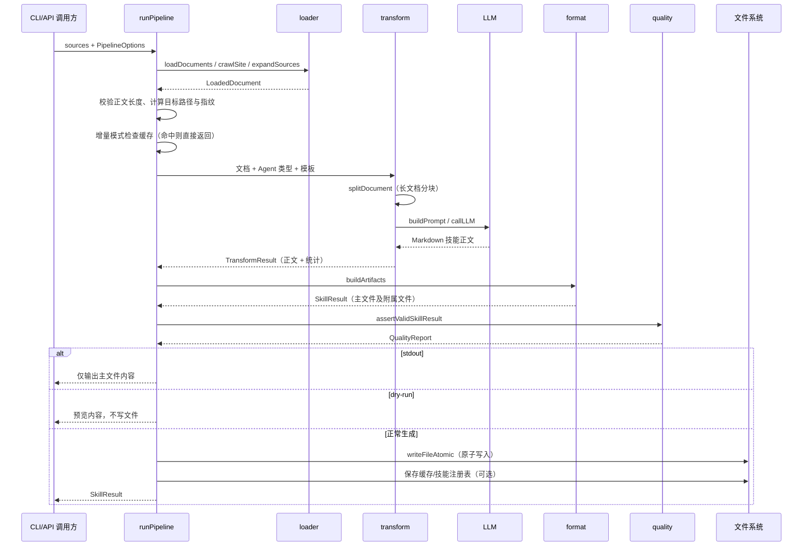

# ai-devtoolkit 架构说明

本文档描述 `ai-devtoolkit` 的运行时边界、核心数据流和模块职责。项目是一个 Node.js/TypeScript CLI，同时提供可编程 API、Web UI 和 MCP Server。

## 1. 总体架构



### 组件边界

- **入口层**：`bin/cli.js` 只负责加载构建产物；`src/cli.ts` 负责参数解析和命令路由。`src/index.ts`/`src/lib.ts` 是无 CLI 副作用的公共 API 入口。
- **生成层**：`pipeline → loader → transform → format` 是核心链路。各阶段使用明确的 TypeScript 类型传递文档、模型配置和生成结果。
- **能力层**：代码搜索、依赖图、环境迁移、规则转换、评测等能力由 CLI 路由，也可从 `lib` 导出供程序调用。
- **服务层**：`server` 提供本地 Web UI，`mcp-server` 提供 MCP stdio 服务；二者复用核心管线而不复制业务逻辑。
- **持久化层**：生成物写入用户指定路径；增量缓存、技能注册表、代码索引和依赖图缓存均是项目目录内的隐藏文件。

## 2. 核心数据流



### 输入到输出的关键规则

1. 输入可以是 URL、Markdown/TXT/HTML/PDF/DOCX、OpenAPI/Swagger、Postman 或目录。
2. `loader` 统一输出 `LoadedDocument`；目录会先扫描，再按批处理或 `--merge` 合并。
3. `transform` 对短文档单次调用 LLM，对长文档执行“分块抽取 → 分层归并 → 最终合成”。
4. `format` 按 Agent 输出现代目录结构：Codex 为 `.agents/skills/<slug>/SKILL.md`，Cursor 为 `.cursor/rules/<slug>.mdc`，Claude 为 `CLAUDE.md`；通过 `--legacy` 可退回旧版单文件。
5. 生成前后都有资源、取消和质量校验；`--stdout` 与 `--dry-run` 均不会写入用户产物。

## 3. 模块职责

### 根入口与服务

| 路径 | 职责 |
| --- | --- |
| `src/index.ts` | 重新导出 `lib.ts`，作为包根入口。 |
| `src/lib.ts` | 汇总所有编程式 API、类型和常量；导入时不触发 CLI。 |
| `src/cli.ts` | Commander 参数定义、命令分流、配置合并和退出码处理。 |
| `src/config.ts` | 读取/保存本地配置和环境变量默认值。 |
| `src/models.ts` | 模型预设、云端/本地模型解析与本地模型探测。 |
| `src/pipeline.ts` | `sources → load → transform → format → write` 统一生成管线。 |
| `src/wizard.ts` | 无参数运行时的交互式向导。 |
| `src/watcher.ts` | 监控本地源文件并触发增量重新生成。 |
| `src/mcp-server.ts` | MCP stdio Server 入口及工具注册。 |
| `src/server.ts` | Web UI HTTP Server 入口和 API 路由组合。 |
| `src/server/html.ts` | Web UI HTML 模板。 |
| `src/server/http.ts` | HTTP 请求解析、响应、安全头和静态页面服务。 |
| `src/server/types.ts` | Web Server 公共类型。 |
| `src/server/validation.ts` | Web API 请求参数校验。 |
| `src/server/ui.html` | UI 源 HTML。 |
| `src/server/ui.generated.ts` | 构建时嵌入的 UI HTML 常量。 |

### 加载与转换

| 路径 | 职责 |
| --- | --- |
| `src/loader/index.ts` | 聚合所有加载器并按来源类型分发。 |
| `src/loader/file.ts` | 本地文本文件加载。 |
| `src/loader/directory.ts` | 目录扫描、扩展名过滤、深度/数量限制。 |
| `src/loader/url.ts` | URL 抓取与文档加载。 |
| `src/loader/crawler.ts` | 文档站点链接发现与深度优先爬取。 |
| `src/loader/readability.ts` | HTML 正文提取和噪声清理。 |
| `src/loader/html.ts` | HTML 加载器。 |
| `src/loader/pdf.ts` | PDF 文本提取。 |
| `src/loader/doc.ts` | DOC/DOCX 文本提取。 |
| `src/loader/openapi.ts` | OpenAPI/Swagger 检测、解析、Markdown 渲染。 |
| `src/loader/postman.ts` | Postman Collection 检测、解析、Markdown 渲染。 |
| `src/transform/index.ts` | 文档转技能的总协调器，处理分块并发和归并。 |
| `src/transform/chunk.ts` | 在标题/段落/代码块安全边界处分块。 |
| `src/transform/prompts.ts` | 抽取、归并、合成等阶段的提示词构造。 |
| `src/transform/llm.ts` | OpenAI 兼容 Chat Completions、超时、取消和重试。 |

### 输出、质量与持久化

| 路径 | 职责 |
| --- | --- |
| `src/format/index.ts` | 聚合输出格式 API。 |
| `src/format/artifacts.ts` | 按 Agent 生成主文件、引用文件和规则文件。 |
| `src/format/frontmatter.ts` | slug、描述提取、YAML frontmatter 注入/校验。 |
| `src/quality/validate.ts` | 产物结构、重复度、长度和质量评分检查。 |
| `src/lifecycle/index.ts` | 技能包生命周期 API 聚合。 |
| `src/lifecycle/registry.ts` | `.devtoolkit-skills.json` 注册表读写、注册、列出、移除。 |
| `src/lifecycle/types.ts` | 生命周期类型。 |
| `src/utils/hash.ts` | 内容哈希、生成指纹、缓存路径和缓存读写。 |
| `src/utils/atomic-write.ts` | 临时文件 + rename 的原子写入。 |
| `src/utils/zip.ts` | 将技能产物打包为 ZIP。 |
| `src/utils/download-store.ts` | Web 下载票据和临时文件存储。 |
| `src/utils/token.ts` | Token/成本估算及格式化。 |
| `src/utils/abort.ts` | 取消、超时、资源上限错误与 AbortScope。 |
| `src/utils/safe-fetch.ts` | 带大小、重定向和超时限制的安全 fetch。 |
| `src/utils/logger.ts` | spinner、日志等级、stderr/stdout 输出。 |

### 代码搜索与依赖分析

| 路径 | 职责 |
| --- | --- |
| `src/search/index.ts` | 搜索 API 聚合入口。 |
| `src/search/scanner.ts` | 代码文件扫描、语言识别和过滤。 |
| `src/search/indexer.ts` | 代码分块、符号提取和索引构建/持久化。 |
| `src/search/searcher.ts` | exact/hybrid/semantic 搜索与排序。 |
| `src/search/explainer.ts` | 用 LLM 解释搜索结果。 |
| `src/search/interactive.ts` | 交互式搜索会话。 |
| `src/search/types.ts` | 搜索索引、文件、分块和查询类型。 |
| `src/graph/index.ts` | 依赖图 API 聚合入口。 |
| `src/graph/analyzer.ts` | TypeScript/JavaScript import/export 依赖分析。 |
| `src/graph/impact.ts` | 目标文件/符号的上下游影响面推导。 |
| `src/graph/mermaid.ts` | 依赖图 Mermaid 文本生成。 |
| `src/graph/cache.ts` | `.devtoolkit-graph.json` 增量缓存。 |
| `src/graph/types.ts` | 图节点、边、统计和缓存类型。 |

### 环境、规则、评测与辅助能力

| 路径 | 职责 |
| --- | --- |
| `src/env/index.ts` | 环境迁移 API 聚合入口。 |
| `src/env/detector.ts` | Homebrew/npm/pip/SDK/VS Code/App/Shell/Git/SSH 探测。 |
| `src/env/exporter.ts` | 生成环境快照和安装脚本。 |
| `src/env/importer.ts` | 读取快照、预览或执行恢复。 |
| `src/env/validate.ts` | 快照结构校验和差异计算。 |
| `src/env/types.ts` | 环境快照类型。 |
| `src/convert/index.ts` | 规则转换/同步 API 聚合。 |
| `src/convert/parser.ts` | 识别并解析各 Agent 规则格式。 |
| `src/convert/converter.ts` | 在规则格式之间转换。 |
| `src/convert/syncer.ts` | 发现项目规则并同步到多个 Agent。 |
| `src/convert/types.ts` | 规则格式、元数据和同步操作类型。 |
| `src/eval/index.ts` | 技能评测 API 聚合。 |
| `src/eval/generator.ts` | 从技能生成评测集和 fallback 用例。 |
| `src/eval/runner.ts` | 执行单模型技能评测并汇总报告。 |
| `src/eval/multi-model.ts` | 多模型对照评测。 |
| `src/eval/types.ts` | 评测用例和报告类型。 |
| `src/security/index.ts` | 敏感信息防护 API 聚合。 |
| `src/security/redact.ts` | 检测并脱敏 API Key、密码、Token 等内容。 |
| `src/doctor/index.ts` | 检查配置、索引和技能包健康度。 |
| `src/repomap/index.ts` | 生成项目结构与符号摘要。 |
| `src/refresh/index.ts` | 生成 GitHub Actions 定时刷新 workflow。 |
| `src/templates/index.ts` | 内置技能模板注册、查询和分类。 |
| `src/types/index.ts` | 跨模块共享领域类型和选项。 |
| `src/types/pdf-parse.d.ts` | `pdf-parse` 的 TypeScript 声明补充。 |
| `src/mcp/handlers.ts` | MCP 工具处理函数。 |
| `src/mcp/protocol.ts` | MCP JSON-RPC 协议适配。 |
| `src/mcp/tools.ts` | MCP 工具定义。 |
| `src/mcp/types.ts` | MCP 类型定义。 |

## 4. 编程式 API 快速示例

### 从 URL 生成 Codex 技能包

```ts
import { devtoolkit } from 'ai-devtoolkit';

const result = await devtoolkit('https://docs.example.com/api', {
  agentType: 'codex',
  name: 'example-api',
  outputPath: '.agents/skills/example-api/SKILL.md',
  llm: {
    apiKey: process.env.DEEPSEEK_API_KEY!,
    model: 'deepseek-chat',
  },
});

console.log(result.suggestedPath, result.quality?.score);
```

### 无 LLM 的加载、格式化与安全检查

```ts
import {
  loadFromFile,
  buildArtifacts,
  detectSensitiveInfo,
} from 'ai-devtoolkit/lib';

const doc = await loadFromFile('./docs/guide.md');
const artifacts = buildArtifacts({
  agentType: 'cursor',
  content: doc.content,
  doc,
  name: 'project-guide',
});
if (!detectSensitiveInfo(artifacts.content).found) {
  // 由调用方决定是否写入 artifacts.artifacts 中的文件。
}
```

更多导出项、类型和参数见 [API Reference](./api.md)。

